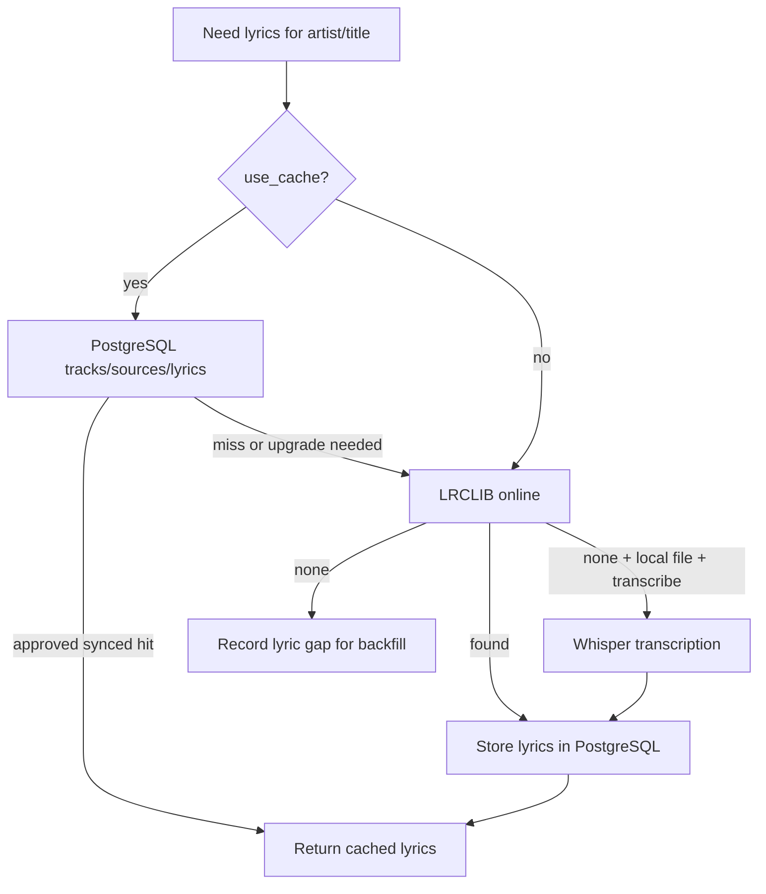

# Local cache and stats

Karaoke's operational library is **PostgreSQL**, accessed through
`localcache.connect()` and configured with `KARAOKE_PG_URL`. It is independent of
the derived OpenSearch indexes, but it is still a database service that must be
available. See [Database backend](database.md) for configuration and schema.

The old `~/.local/share/karaoke/karaoke.db` is a legacy migration snapshot, not a
live cache. Changing `KARAOKE_DATA_DIR` changes file-cache locations, not the
PostgreSQL connection. `KARAOKE_DB_BACKEND` and `KARAOKE_DB_URL` do not select the
operational backend; use `KARAOKE_PG_URL`.

## What the operational store does

1. **Lyrics cache:** reuse approved plain/synced lyrics for known tracks without
   needing OpenSearch or a fresh lyric-provider request.
2. **Playback and discovery history:** persist plays, recognition results and
   cache activity for reporting.
3. **Library state:** retain source URLs, analysis, artist identities, playlists,
   recordings and backfill gaps across processes and restarts.

"Offline" here means avoiding external providers for cached data. PostgreSQL
must remain reachable. Identifying an unknown song from sound still uses
`songrec` and Shazam online; cached recognition results are not a local acoustic
fingerprint index.

## Lyrics lookup order

`player.get_synced()` checks the operational cache before external lyric lookup.
Browser/player detection also prefers the source URL to often-stale display
metadata; see [Flows](flows.md).



OpenSearch is not the source of truth for this hot path. Rebuild its derived
track/line documents with `make vector-index` when semantic search needs fresh
data; see [Vectors](vectors.md).

## Stats

`cli.stats_main()` aggregates playback/discovery data, using the API client or
its PostgreSQL-backed fallback. The Makefile provides the supported summary
command:

```bash
make stats
```

For options from a source checkout:

```bash
PYTHONPATH=src .venv/bin/python -c 'from karaoke.cli import stats_main; raise SystemExit(stats_main())' --days 7
PYTHONPATH=src .venv/bin/python -c 'from karaoke.cli import stats_main; raise SystemExit(stats_main())' --json
```

The parser calls itself `karaoke-stats`, but the current project metadata does
not install a standalone command with that name.

Recorded event types include:

| Event | Meaning |
| --- | --- |
| `discover` | Radio/live mode identified a new song. |
| `relock` | Radio re-anchored a song's position. |
| `play` | A playback/lyric-rendering play was recorded. |
| `cache_hit` | Lyrics were served from the operational cache. |
| `cache_miss` | Local lyrics were unavailable; external lookup was needed. |
| `no_lyrics` | No lyrics were found for the track. |

The records include mode and source, allowing reporting by radio, Spotify,
listen/output, file and query use. See [Database backend](database.md) for the
unified event store and compatibility reporting tables/views.

## Core table responsibilities

| Table | Responsibility |
| --- | --- |
| `tracks` | Track identity, title/artist metadata, duration and play counters. |
| `sources` | YouTube/Spotify URLs, local paths and player sources for a track. |
| `lyrics` | Approved plain and synced lyrics and their source. |
| `lyric_gaps` | Missing-lyrics work for backfill. |
| `artists`, `track_artists` | Canonical MusicBrainz artists and track credits. |
| `saved_playlists`, `saved_playlist_tracks` | Persistent playlists and ordering. |
| `track_analysis`, `track_moods`, `track_chords` | Audio analysis and timelines. |

For actual PostgreSQL DDL, constraints, IDs and table ownership, use
[Database backend](database.md) and the schema authority in
`scripts/migrate_sqlite_to_postgres.py`; do not use the old SQLite
`AUTOINCREMENT` examples as setup instructions.

## File caches and task results

Downloaded audio, artwork and logs use `KARAOKE_DATA_DIR` (normally
`~/.local/share/karaoke`). They are files, not the operational database.
Celery may retain task results in `celery-results.sqlite`; this is an intentional,
separate SQLite store controlled by `CELERY_RESULT_BACKEND` /
`KARAOKE_CELERY_RESULT_DB`, not a fallback music library.
