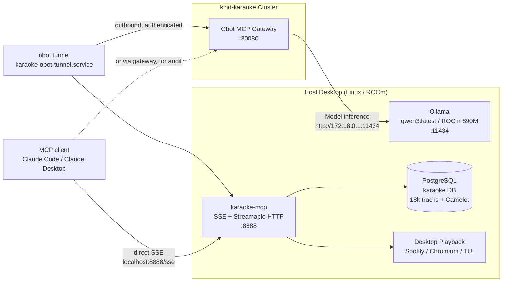

# Karaoke AI DJ MCP Server & Obot Integration

The Karaoke AI DJ MCP Server bridges your 18,000+ local track library, harmonic analysis, lyrics sentiment, and desktop playback control to AI agent platforms like **Obot**, **Ollama**, and **Claude**.

## Architecture



Obot rejects any MCP server URL that resolves to a private IP, so it cannot
reach `:8888` directly. The `obot tunnel` process on the host opens an
authenticated outbound connection instead, and the gateway routes through it.

## Endpoints

One port serves two MCP transports, because clients disagree about which to
use: Claude Code opens a long-lived SSE stream, while Obot posts JSON-RPC
(Streamable HTTP). Serving only SSE answered Obot's POSTs with 405.

| Path | Method | Behaviour |
|---|---|---|
| `/sse`, `/mcp` | `GET` with `Accept: text/event-stream` | Legacy SSE stream; replies with an `event: endpoint` naming the session's POST-back URL |
| `/sse`, `/mcp` | `POST` | Streamable HTTP JSON-RPC |
| `/sse`, `/mcp` | `HEAD` | `200`, for the unit's `ExecStartPost` readiness probe |
| `/messages/` | `POST` | Where an SSE session posts its requests |
| `/health` | `GET` | `{"status": "ok"}` |
| `/` | `GET` | `{"status": "ok", "server": "karaoke-dj"}` |

A `GET` is routed to SSE only when it asks for `text/event-stream` and carries
no `mcp-session-id` header; anything else falls through to Streamable HTTP. A
plain `curl http://localhost:8888/sse` therefore returns `400`, not because the
server is unhealthy but because curl sends no `Accept` header — use `-H "Accept:
text/event-stream"`, or just hit `/health`.

## Available MCP Tools

| Tool | Purpose | Key Parameters |
|---|---|---|
| `search_songs` | Search tracks in the library with Camelot codes, BPM, energy, and lyrics | `query`, `genre`, `key`, `min_bpm`, `max_bpm`, `only_synced_lyrics` |
| `get_now_playing` | Inspect currently playing audio on Spotify/Chromium/VLC/MPRIS | — |
| `suggest_next_tracks` | Harmonic transitions (Camelot wheel), energy flow, timbre (CLAP), structural chords, lyric context, or emotional mood | `track_id`, `strategy` (`harmonic`, `energy_up`, `cool_down`, `acoustic`, `structural`, `context`, `mood`), `exclude_playlist` |
| `analyze_lyric_vibe` | Lyric mood arc, sentiment breakdown, and singer delivery tips | `track_id` |
| `get_dj_stats` | Play counts, top artists, crowd favorites, and discovery history | — |
| `play_track` | Trigger playback via the host karaoke player | `track_id`, `prefer_audio_only` |
| `add_to_dj_playlist` | Add track to the persistent `dj-list` playlist by ID or title/artist; re-adding is a no-op | `track_id`, `artist`, `title`, `playlist_id` |
| `get_dj_playlist` | Retrieve tracks, positions, and metadata from the DJ playlist | `playlist_id` (default `dj-list`) |
| `clear_dj_playlist` | Empty all tracks from the DJ playlist | `playlist_id` (default `dj-list`) |
| `get_similarity_graph` | Generate node-link graph data across chord motion, semantic lyrics, emotional mood, CLAP timbre, or Camelot keys | `track_id`, `playlist_id`, `strategy` (`structural`, `context`, `mood`, `acoustic`, `harmonic`), `hops`, `limit_per_node` |

### Interactive Similarity Constellation (`/graph`)

The server mounts an interactive **Cytoscape.js** graph explorer directly on:
* **`http://localhost:8888/graph`**
* Parameterized views: `http://localhost:8888/graph?track_id=14945&strategy=structural`, `http://localhost:8888/graph?track_id=18227&strategy=context`, `http://localhost:8888/graph?playlist_id=jazz-funk-happy`

Features:
* **Multi-Modal Similarity Dimensions:**
  * **Structural (Chord Motion):** CQT chroma 96-chord template matching and root-motion k-NN in OpenSearch (`karaoke-progression`).
  * **Context (Lyrics & Meaning):** Dense 384-dimensional semantic embeddings (`lyrics_vector` in OpenSearch `tracks` index) across 18,700+ songs, connecting tracks by lyrical narrative, theme, and storytelling.
  * **Mood (Emotion & Feeling):** 4D emotional arc distribution (`sentiment_vector` [happy, sad, angry, tender]) and `dominant_mood` valence matching.
  * **Acoustic (CLAP Timbre):** Contrastive audio-language pretraining sound embeddings.
  * **Harmonic (Camelot Key):** Circle of fifths key compatibility (+/- 1 hour or relative major/minor).
* **Physics-based CoSE Layout:** Nodes naturally cluster into stylistic, thematic, and harmonic constellations.
* **Dual Color Encodings:** Color-coded by Camelot harmonic code (1A–12B wheel) or emotional mood (`happy` amber, `tender` emerald, `sad` blue, `angry` crimson, `neutral` slate).
* **Interactive Inspection & Desktop Playback:** Clicking any node reveals its detected key, BPM, macro form (`diatonic-vamp`, `modulating`), fifths ratio, mood, sentiment hits, and distinct chord count, with one-click **"▶ Play on Desktop"** playback triggering (supporting both POST and GET `/api/play`).
* **Obot Integration:** Obot agents can call `get_similarity_graph` via JSON-RPC to discover multi-hop bridges between musical genres or render the graph inside web frames.

### Structural & Chord Progression Intelligence

The MCP server connects to OpenSearch's `karaoke-progression` index (~7,400+ indexed tracks) to support two levels of harmonic analysis:

1. **Macro Key Movement (Song Form)**:
   * **`diatonic-vamp`**: Tracks that sit in one key and loop diatonic chords (IV, V, vi), typical of blues and rock.
   * **`static`**: Pure tonal stability without key modulation.
   * **`modulating`**: Definite travel between tonal centers.
   * **`static-with-mixture`**: Modal mixture (e.g. borrowing parallel minor chords in a major key).
   * **`truck-driver`**: Classic late modulation up a half/whole step in the final chorus.
   * **`restless` & `oscillating`**: Frequent key shifts (>1.5/min) or back-and-forth vamping between two centers.

2. **Micro Root Motion (`chord_motion`)**:
   * Evaluated every 0.25 seconds using CQT chroma matched against an expanded 96-template chord vocabulary:
     * Triads: `maj`, `min`, `sus4`
     * 7th Chords: Dominant `7`, `maj7`, Minor `min7`, Half-diminished `m7b5`, Diminished `dim7`
   * Key-invariant 12-dimensional root motion histogram modulo 12.
   * **`fifth_ratio`**: Measures descending-fifth motion (the engine of ii-V-I progressions in jazz and funk).
   * The **`structural`** strategy in `suggest_next_tracks` performs cosine k-NN vector search over `chord_motion` in OpenSearch, surfacing tracks that share the exact chord movement architecture (e.g. linking Art Blakey to Django Reinhardt).

### The set never repeats itself

`suggest_next_tracks` filters out anything already in the DJ list, so working
through `/suggest` keeps producing fresh material instead of re-offering songs
you just queued. Pass `exclude_playlist=""` to lift the filter, or name another
saved playlist to exclude that one instead.

`add_to_dj_playlist` is idempotent to match: re-adding a queued song returns
`already_present` rather than a duplicate, and short-circuits before the
YouTube Music call, so a repeat add costs no API request.

## Service Management

The MCP server runs as a systemd `--user` service:

```bash
systemctl --user status karaoke-mcp     # Check service status
systemctl --user restart karaoke-mcp    # Restart service
make mcp                               # Run manually in foreground
```

## Connecting Obot to the DJ

1. **Access Obot**:
   Open [http://172.18.0.2:30080](http://172.18.0.2:30080) in your browser.
2. **Configure Model Provider (Ollama)**:
   * Go to **Model Providers** -> **Ollama**.
   * Set **Host** to `http://172.18.0.1:11434`.
   * Enable model `qwen3:latest` (or `qwen3:1.7b` for ultra-low latency).
3. **Start the tunnel** (required — see the note under Architecture):
   * In Obot, go to **MCP Servers -> Tunnels -> Create MCP Tunnel**.
   * Set **Allowed URLs** to `http://127.0.0.1:8888/*` so the tunnel can reach
     nothing else on the host.
   * Save the one-time secret into `~/.config/obot/tunnel.env` as
     `OBOT_TUNNEL_TOKEN`, then `systemctl --user enable --now karaoke-obot-tunnel`.
   * Verify the tunnel shows **Connected** before continuing.
4. **Register the Karaoke MCP Server**:
   * Go to **MCP Servers -> Add MCP Server -> Remote Server**.
   * **Exact URL**: `http://127.0.0.1:8888/sse`
   * **Tunnel**: select the tunnel from step 3. Without this the save fails
     validation.

   Obot reaches the server as `POST /sse`, which is why the Streamable HTTP
   transport has to be served there. Confirm traffic is flowing with
   `journalctl --user -u karaoke-obot-tunnel -f`, which logs one line per
   proxied request.

## Talking to the DJ

### In the Karaoke TUI (`D` key)

You can chat with the AI DJ directly inside the Karaoke TUI:
- Press **`D`** anywhere in the TUI to open the **AI DJ Chat Booth** modal.
- Use the quick action buttons or slash commands:
  - `/now` — Track, player, detected Camelot key, and BPM
  - `/suggest [harmonic|energy_up|cool_down|acoustic]` — Next song flow
  - `/vibe [track_id]` — Lyric mood arc, sentiment breakdown, and singing delivery tips
  - `/stats` — Crowd anthems, hit counts, and cache statistics
  - `/search <query>` — Search the 18,000+ local track library
  - `/play <track_id>` — Launch track playback on the host player
  - `/model <name>` — Switch Ollama model (e.g. `qwen3:1.7b`, `qwen3:latest`)
- Or run standalone in your terminal: `make dj` or `karaoke-dj`.
- Connects to local **Ollama** (`qwen3:1.7b` / `qwen3:latest`) with instant deterministic fallback to local library tools if the LLM is offline or busy.

### Using External MCP Clients (Claude Code / Claude Desktop)

Obot Community is an MCP gateway, not a chat product: it has no agent builder
and no chat window. Point an MCP client at the server instead.

Directly, bypassing the gateway:

```bash
claude mcp add --scope local --transport sse karaoke http://localhost:8888/sse
```

In **Antigravity**, add the server to `~/.gemini/config/mcp_config.json`:

```json
{
  "mcpServers": {
    "karaoke": {
      "serverUrl": "http://localhost:8888/sse"
    }
  }
}
```

Or through Obot when you want its audit log and access policies in the path.

Either way the client supplies the persona. A system prompt that works well:

> *"You are an energetic, charismatic Karaoke DJ and MC. You know every track in
> our 18,000+ song library. Use harmonic mixing (Camelot wheel) and BPM pacing to
> keep the room dancing. Suggest songs that match the singers' energy, warn them
> about tough high notes, and hype up the crowd!"*

Note that `search_songs(query=...)` is a substring match on artist/title/album,
not semantic search. Vibe phrasing like "90s rock anthem" returns nothing —
filter on `genre`, `min_bpm`/`max_bpm`, `key` and `only_synced_lyrics` instead.
